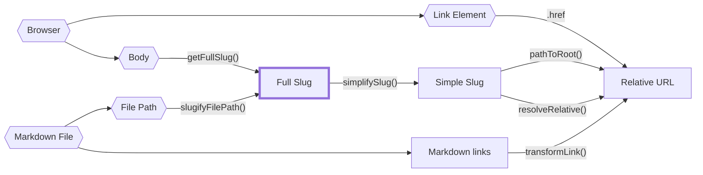

路径这件事相当难以理清，尤其是对静态站点生成器而言，它们可能来自太多地方。

指向某份内容的完整文件路径？也是路径。某份内容的 slug 呢？又是另一种路径。

把所有这些都标注为 `string` 就完事是很傻的做法，因为不小心把一种路径当成另一种路径相当常见。不幸的是，TypeScript 的类型别名没有[名义类型](https://en.wikipedia.org/wiki/Nominal_type_system)，这意味着即使你为服务端 slug 或客户端 slug 定义了自定义类型，你仍然可能不小心把其中一个赋值给另一个，而 TypeScript 不会发现。

幸运的是，我们可以用[品牌标记](https://www.typescriptlang.org/play#example/nominal-typing)来模拟名义类型。

```typescript
// 而不是
type FullSlug = string

// 我们这样做
type FullSlug = string & { __brand: "full" }

// 这样，下面这行会通不过类型检查
const slug: FullSlug = "some random string"
```

虽然这能避免名义类型系统 _内部_ 的大多数类型错误（例如把服务端 slug 误当成客户端 slug），但它无法避免我们在强制转换时 _不小心_ 把字符串当成客户端 slug。

因此，在「入口点」把字符串转换为这些名义类型之一时，我们仍需小心，这些入口点在下图中以六边形表示。

下图描绘了所有路径来源、名义路径类型之间的关系，以及 `quartz/path.ts` 中哪些函数在它们之间做转换。



以下是 slug 的主要类型，以及对每种路径类型的粗略说明：

- `FilePath`：磁盘上某个文件的真实文件路径。不能是相对路径，且必须带有文件扩展名。
- `FullSlug`：不能是相对路径，且不能有开头或结尾的斜杠。它的最后一段可以是 `index`。尽可能使用它，因为它是对 slug 最「通用」的解释。
- `SimpleSlug`：不能是相对路径，且不应以 `/index` 结尾，也不应带文件扩展名。不过它 _可以_ 带末尾斜杠来表示文件夹路径。
- `RelativeURL`：必须以 `.` 或 `..` 开头，以表示它是相对 URL。不应以 `/index` 结尾，也不应带文件扩展名，但可以包含末尾斜杠。

要更清楚地了解它们之间的相互关系，可以查看 `quartz/util/path.test.ts` 中的路径测试。
