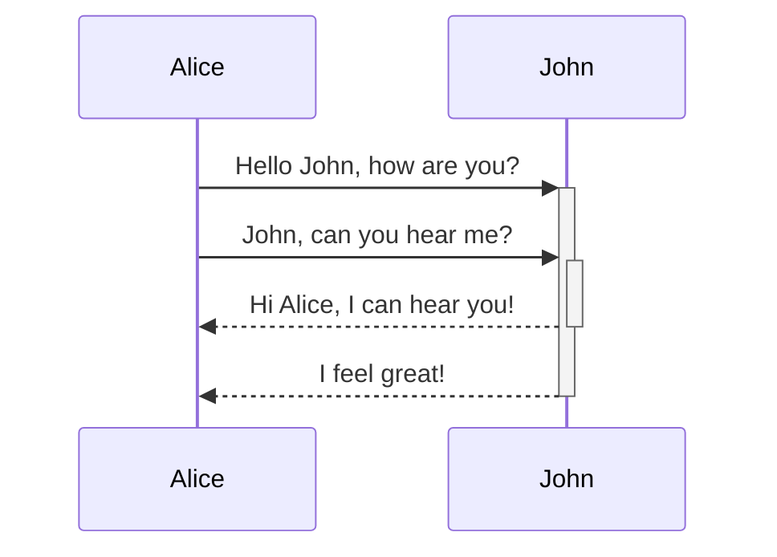

Quartz 支持 Mermaid，它允许你在笔记中添加图表和图形。Mermaid 支持多种图表，例如[流程图](https://mermaid.js.org/syntax/flowchart.html)、[时序图](https://mermaid.js.org/syntax/sequenceDiagram.html)和[时间线](https://mermaid.js.org/syntax/timeline.html)。该功能作为 [[Obsidian compatibility]] 的一部分启用，可以在该插件中配置以及启用/禁用。

默认情况下，Quartz 渲染 Mermaid 图表时会匹配站点主题。

> [!warning]
> 想知道为什么即使启用了 Mermaid 图表却没有显示？你可能需要重新排序插件，使 [[ObsidianFlavoredMarkdown]] 位于 [[SyntaxHighlighting]] _之后_。

## 语法

要添加 Mermaid 图表，请创建一个 mermaid 代码块。

````

````


