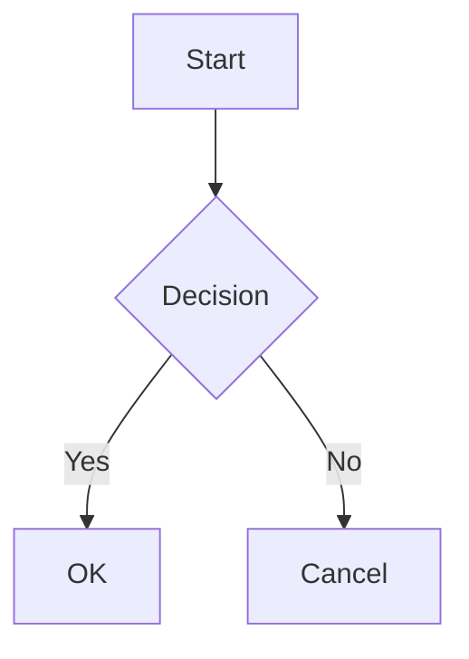

Quartz 最初是作为将 Obsidian 库发布为网站的工具而设计的。即使随着时间推移 Quartz 的范围不断扩大，它也没有失去与 Obsidian 无缝互操作的能力。

默认情况下，Quartz 附带 [[ObsidianFlavoredMarkdown]] 插件，它是一个转换器插件，增加了对 [Obsidian Flavored Markdown](https://help.obsidian.md/Editing+and+formatting/Obsidian+Flavored+Markdown) 的支持。这包括对 [[wikilinks]] 和 [[Mermaid diagrams]] 等特性的支持。

它还通过 [[Frontmatter]] 转换器插件支持 [frontmatter 解析](https://help.obsidian.md/Editing+and+formatting/Properties)，并使用与 Obsidian 相同的字段。

最后，Quartz 还提供 [[CrawlLinks]] 插件，允许你自定义 Quartz 的链接解析行为，以与 Obsidian 保持一致。

## 支持的特性

### 维基链接

使用 `[[page]]` 语法的内部链接会被转换为常规链接。更多细节请参阅 [[wikilinks]]。所有变体都受支持：

```markdown
[[Page]] Link to a page
[[Page|Custom text]] Link with alias
[[Page#Heading]] Link to a heading
[[Page#Heading|Custom text]] Link to a heading with alias
[[Page#^block-id]] Link to a block reference
![[Page]] Embed (transclude) a page
![[image.png]] Embed an image
![[image.png|alt 100x200]] Embed with alt text and dimensions
```

在表格中，维基链接中的竖线可以用反斜杠转义：

```markdown
| Column          |
| --------------- |
| [[page\|alias]] |
```

### 高亮

用 `==` 包裹文本即可高亮：

```markdown
This is ==highlighted text== in a sentence.
```

渲染结果为：This is ==highlighted text== in a sentence.

### 注释

Obsidian 风格的注释会从输出中剥离：

```markdown
This is visible. %%This is a comment and won't appear.%%
```

渲染结果为：This is visible. %%This is a comment and won't appear.%%

多行注释同样受支持：

```markdown
%%
This entire block
is a comment.
%%
```

### 标签

以 `#` 开头的标签会被解析并链接到标签页：

```markdown
#tag #nested/tag #tag-with-dashes
```

例如：#feature/transformer

> [!note]
> 像 `#123` 这样的纯数字标签会被忽略，这与 Obsidian 的行为一致。

### 标注块

[[callouts|Obsidian 标注块]] 完全受支持，包括可折叠的变体：

```markdown
> [!note]
> This is a note callout.

> [!warning]- Collapsed by default
> This content is hidden initially.

> [!tip]+ Expanded by default
> This content is visible initially.
```

> [!example] 实时示例
> 这是从 Obsidian 风格 Markdown 渲染出的实时标注块。

所有内置标注块类型都受支持：`note`、`abstract`、`info`、`todo`、`tip`、`success`、`question`、`warning`、`failure`、`danger`、`bug`、`example` 和 `quote`，以及它们的别名。

### 任务列表与自定义任务字符

标准复选框开箱即用。启用 `enableCheckbox: true` 后，你还可获得对 Obsidian 社区中流行的自定义任务字符的支持：

```markdown
- [ ] Unchecked
- [x] Checked
- [?] Question
- [!] Important
- [>] Forwarded
- [/] In progress
- [-] Cancelled
- [s] Special
```

每个自定义字符都会作为 `data-task` 属性保留在渲染出的元素上，从而允许按字符进行基于 CSS 的样式设置。

- [ ] Unchecked
- [x] Checked
- [?] Question
- [!] Important

### Mermaid 图表

[[Mermaid diagrams|Mermaid]] 代码块会被渲染为图表：

````markdown

````


### YouTube 嵌入

YouTube 视频可以使用标准图片语法配合 YouTube URL 来嵌入：

```markdown


```

例如，下面的嵌入内容由 `` 渲染而来：


### 推文嵌入

来自 Twitter/X 的推文会被嵌入为静态引用块，并附带指向原推文的链接：

```markdown


```

例如，下面的嵌入内容由 `` 渲染而来：


### 块引用

块引用允许链接到页面中的特定块：

```markdown
Content paragraph. ^my-block

[[Page#^my-block]]
```

### Obsidian URI 链接

使用 `obsidian://` 协议的链接会被标记一个 CSS 类（`obsidian-uri`）和一个 `data-obsidian-uri` 属性，因此你可以为它们设置与常规链接不同的样式。

### 视频嵌入

视频文件可以使用标准图片语法来嵌入：

```markdown


```

### 在 HTML 中嵌入

默认情况下，Obsidian 不会在 HTML 块内渲染其 Markdown 语法。Quartz 通过 `enableInHtmlEmbed` 选项扩展了这一点，它会在原始 HTML 节点内解析维基链接、高亮和标签。

### 脚注

使用 `[^1]` 语法的脚注通过 [[GitHubFlavoredMarkdown]] 插件完全受支持：

```markdown
Here is a sentence with a footnote.[^1]

[^1]: This is the footnote content.
```

## Obsidian 社区插件支持

Quartz 专注于支持 Obsidian 的核心特性。来自 Obsidian 社区插件的功能由 Quartz 社区插件处理：

| Obsidian 插件  | Quartz 支持                                                                                                                              |
| --------------- | ------------------------------------------------------------------------------------------------------------------------------------------- |
| Dataview        | 通过 [Quartz Syncer](https://community.obsidian.md/plugins/quartz-syncer) 支持 —— 在同步期间将 Dataview 查询导出为静态内容 |
| Excalidraw      | 通过 `obsidian-plugin-excalidraw` 社区插件支持                                                                             |
| Leaflet Maps    | 通过 `obsidian-plugin-leaflet` 社区插件支持                                                                                |
| Style Settings  | 通过 `quartz-themes` 社区插件支持                                                                                          |

> [!tip]
> 一般规则是：Obsidian 核心特性由 Quartz 直接支持，而 Obsidian 社区插件特性由相应的 Quartz 社区插件支持。并非所有 Obsidian 社区插件都有对应的 Quartz 实现，但流行的插件很可能会得到社区支持。

## 配置

此功能由 [[ObsidianFlavoredMarkdown]]、[[Frontmatter]] 和 [[CrawlLinks]] 插件提供。有关自定义选项，请参阅插件页面。
